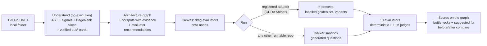

# EvalGraph

**Paste your LLM app's repo. See where it breaks.**

EvalGraph reads an LLM application's source code (without running it) and builds an architecture graph (agents, retrievers, LLM calls, tools, memory). It flags evaluation hotspots with evidence and lets you drag evaluators onto the graph in an n8n-style canvas. Running the evaluation paints the scores onto the architecture, and you can try a suggested fix and compare before and after.

Hackathon POC. All phases are built (PHASE-00 to PHASE-10, plus 03B universal understanding and 06B Docker sandbox). Verified in mock mode **and against real DIAL** (2026-10-03): real analysis, 8 recorded CUDA Archer runs, and a Docker-sandboxed app answering through DIAL. Real numbers: `docs/DEMO-SCRIPT.md`. Team decisions and open questions: `docs/conf/conf_00_index.md`.



## What's real vs mocked
| Part | Status |
|---|---|
| Analysis (graph, hotspots, evidence lines) | Real, static. With DIAL an LLM refines labels and reviews hotspots; offline it uses static cards. Tested on 8 zoo apps + 6 public repos |
| Running CUDA Archer / any repo in Docker | Real execution. In mock mode the LLM answers are canned (`[MOCK] …`); retrieval, tools, guardrail logic and local models run for real |
| Deterministic scores (retrieval precision/recall, routing, tool args, numbers, injection, latency, cost) | Computed from real spans. LLM-dependent ones (routing, tool args, injection) are only meaningful with DIAL |
| LLM-judge scores (faithfulness, relevance, safety, task completion) | Real with DIAL (judge `claude-haiku-4-5`, counting rubric). **Pseudo values in mock mode**, labelled MOCK |
| Fix → re-run → compare on any repo | Rule-based literal patches (e.g. `TOP_K 10 → 4`), applied only inside the sandbox; the repo is never changed; diff downloadable. Measured on a real DIAL run (PHASE-09) |
| Sandbox network | Allowlist by default: only package registries, git hosts, Hugging Face and DIAL are reachable; blocked hosts are reported with the run (PHASE-10) |
| Replay mode (`EVALGRAPH_REPLAY=1`) | Serves a recording made with `scripts/record_demo.ps1`, labelled REPLAY (REPLAY · MOCK if recorded in mock mode). `fixtures/demo/` holds a **real** recording (2026-10-08, DIAL): CUDA Archer, 8 variants × 41 samples |

**Demo target:** [CUDA Archer](https://github.com/SunilKumarPradhan/cuda-archer), an LLM CUDA co-pilot on DIAL with 14 measurable bottlenecks. Clone it next to this repo (`../cuda-archer`).

**LLM access:** DIAL (Azure OpenAI-compatible proxy) only. It needs the company network/VPN; everything else runs in mock mode.

## Start here
- **Testers:** `docs/TESTING-GUIDE.md` (setup, test scenarios, bug reports)
1. `docs/00-OVERVIEW.md`: what and why
2. `docs/01-SETUP-WINDOWS.md`: set up your PC
3. `docs/03-TEAM-WORKFLOW.md`: lanes, git flow, how to hand a phase to Claude
4. `docs/phases/`: PHASE-00 → PHASE-08

## Quick start
```powershell
cd backend; copy .env.example .env; uv sync; uv run pytest -q
cd ..\frontend; npm install
cd ..; .\scripts\dev.ps1     # UI http://localhost:5173 · API http://localhost:8000/api/health
```
Runs without DIAL access in mock mode (`EVALGRAPH_MOCK_LLM=1`, `ARCHER_MOCK_LLM=1`).

UI without backend: http://localhost:5173/?fixtures=1 · End-to-end UI check (Playwright + installed Edge, dev server running): `cd frontend; npm run ui:check` (add `-- http://localhost:5173 ui-shots --backend` to test against the API).

Before a demo: `.\scripts\prewarm.ps1` (checklist with fallbacks) · end-to-end API check: `.\scripts\smoke.ps1` · record the demo on VPN: `.\scripts\record_demo.ps1`, then start with `$env:EVALGRAPH_REPLAY='1'`.
